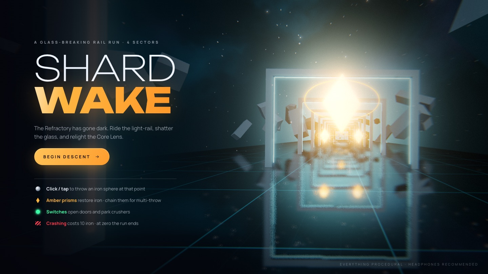
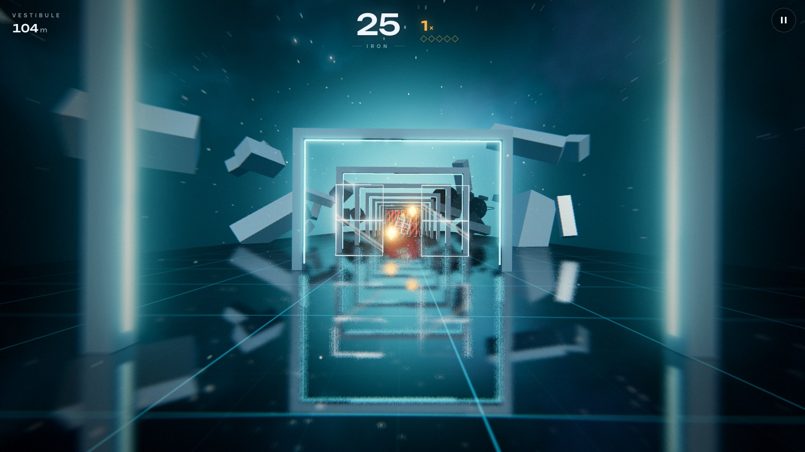
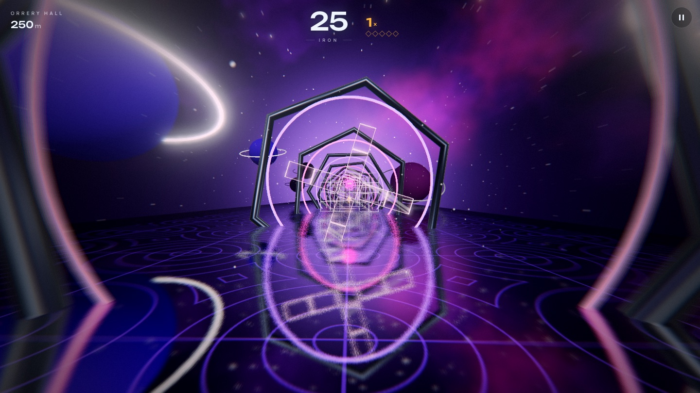
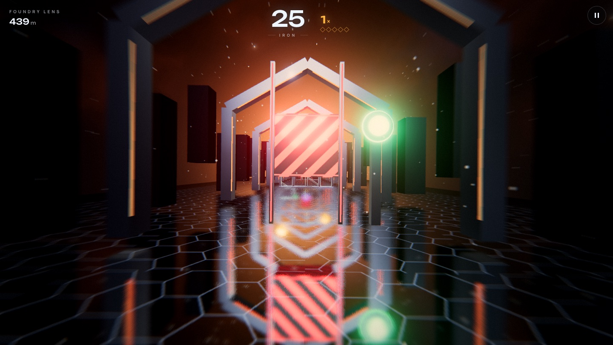
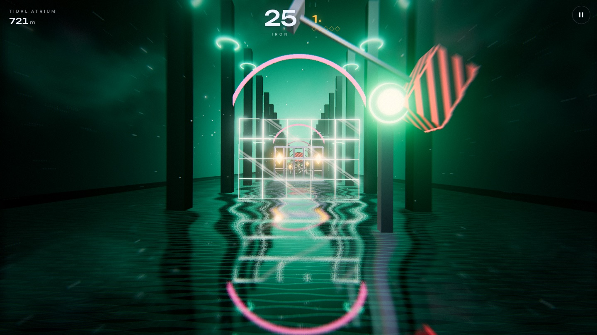
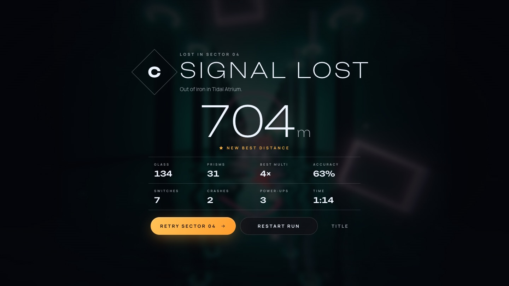
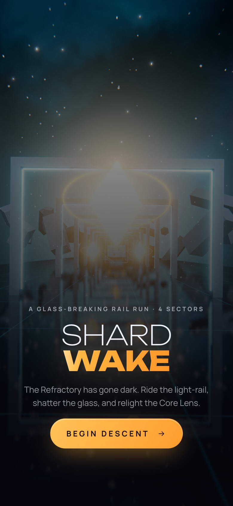

<div align="center">

# SHARDWAKE

**A glass-breaking rail shooter that runs in your browser.**

Ride the light-rail through a derelict station, throw iron spheres to shatter the glass in your path, and relight the Core Lens.

[](https://threejs.org)
[](https://vitejs.dev)
[](LICENSE)



</div>

---

## About

SHARDWAKE is a first-person rail shooter. The camera moves forward on its own, so you never steer. All you do is aim and throw, and every throw costs ammunition. Break the glass before you hit it, shoot amber prisms to refill, and chain prism hits to throw more spheres at once.

> **The Refractory** is an abandoned light-station adrift in a dim nebula. Its halls were built from lens-glass to focus starlight into the **Core Lens**, which has since gone dark. You're a maintenance drone pulled along the station's old light-rail, with nothing but a hopper of iron spheres. Get through four sectors and relight the Core.

Every visual and every sound is **generated in code**: geometry, shaders, canvas textures, and music and sound effects synthesized with the Web Audio API. There are no image, model or audio files in the repository.

The game is inspired by the core loop of *Smash Hit* (Mediocre, 2014). It's an independent fan project with its own name, setting, levels, art and music, and isn't affiliated with or endorsed by Mediocre.

## Screenshots

| | |
|---|---|
|  |  |
| **Vestibule:** pale portals and floating monoliths | **Orrery Hall:** rotating rings and a nebula sky |
|  |  |
| **Foundry Lens:** crushers you park with a switch | **Tidal Atrium:** pendulums over a rippling floor |

<p align="center">
  
  &nbsp;
  
</p>

## Play

You need [Node.js](https://nodejs.org) 18 or newer.

```bash
git clone https://github.com/muinsaiyed/Shardwake.git
cd Shardwake
npm install
npm run dev
```

Open **http://localhost:5173**. The dev server also listens on your local network, so you can open the address it prints on a phone on the same Wi-Fi. Headphones recommended.

### Controls

| Input | Action |
|---|---|
| **Click / tap** anywhere | Throw an iron sphere at that point |
| **Hold** (during Overdrive) | Throw continuously |
| **Esc** / **P** / ❚❚ | Pause and resume |

## How to play

- **Ammo.** You start with **25** iron spheres. Each throw costs **1**, however many spheres it releases.
- **Crashing.** Hitting glass or metal costs **10** spheres and resets your streak. At **0** the run ends.
- **Prisms.** Amber prisms restore **+3** (small) or **+5** (large, ringed).
- **Multi-throw.** Every **5 prisms in a row** adds a sphere to each throw, up to **5 at once**. The ×N counter and diamond pips show progress. Letting a prism slip past, or crashing, resets it to 1×.
- **Switches.** Green switches open hazard-striped doors (the later doors need up to four) and park crushers and pendulums out of your path.
- **Power-ups.** Hit one with a sphere to activate it:

  | Power-up | Duration | Effect |
  |---|---|---|
  | **Overdrive** (magenta ∞) | 6 s | Unlimited spheres; hold to stream |
  | **Nova Rounds** (violet starburst) | 8 s | Explosive spheres that clear nearby glass and wreck crushers and pendulums |
  | **Stasis** (cyan hourglass) | 6 s | Slows the world to 45 % |

- **Checkpoints.** Reaching a sector unlocks it on the title screen. After a game over you can retry from the sector where you ran out. Your best distance and unlocked sectors are saved in the browser.

### The four sectors

| # | Sector | Look | What it introduces |
|---|---|---|---|
| 1 | **Vestibule** | Pale teal portals, floating monoliths | Glass panes and walls, sliding panes, a tumbling glass cube, the first switch door |
| 2 | **Orrery Hall** | Violet rings, ringed planets, nebula | Spinning glass fans, orbiting prisms, Overdrive into triple glass walls, metal lattices |
| 3 | **Foundry Lens** | Steel hex frames, beat-driven pistons | Crushers, Nova Rounds, counter-sliding panes, a 3-switch door |
| 4 | **Tidal Atrium** | Towering pillars over rippling water | Pendulums, Stasis, counter-rotating fans, the 4-switch final gate |

Each sector has its own synthesized soundtrack (96 → 108 → 120 → 126 BPM), and the moving obstacles are locked to the beat.

## Under the hood

Built with [three.js](https://threejs.org) and [Vite](https://vitejs.dev), in plain JavaScript with no framework.

- **Physics.** Custom swept collision (segment vs. oriented box and sphere), so fast spheres never tunnel through thin glass. The aim ray uses the same colliders as the physics, so spheres land where you point.
- **Glass.** A GLSL shader draws crisp rims from each pane's real dimensions, adds a fresnel sheen with a thin-film iridescent tint, and sweeps a specular glint across. Pooled shards are drawn through a single `InstancedMesh`.
- **Scene.** A planar-reflection mirror floor (with a water ripple in the Atrium), a procedural nebula sky that blends into the fog, and drifting dust.
- **Post-processing.** HDR bloom with MSAA, then a finishing pass: speed blur, chromatic aberration that spikes on impacts, per-sector colour grading, vignette and film grain.
- **Audio.** A small step sequencer (kick, hats, clap, saw bass, arps, pads, generated reverb) plus about 14 synthesized sound effects, including glass shatter, crash and prism chimes.
- **Auto-quality.** If the frame rate drops, the game turns off the mirror, then bloom, then lowers the resolution.

### Project layout

```
index.html          HUD and menu markup
src/main.js         UI: HUD, title / pause / results screens, checkpoints
src/game.js         Rail movement, camera, shooting, collision, rules, render loop
src/entities.js     Glass panels, fans, lattices, prisms, switches, doors, crushers, pendulums, power-ups
src/rooms.js        Sector palettes, decor and obstacle layouts
src/look.js         Glass shader, sky, mirror floor, finishing pass, dust, impact rings
src/fx.js           Glass shards, sparks and trails
src/audio.js        Music sequencer and sound effects
docs/RESEARCH.md    Research notes on the reference game's mechanics
tests/              Automated playtest and screenshot scripts
```

Want to design your own sector? Each one is a short list of `P.add(distance, Entity, options)` calls in [`src/rooms.js`](src/rooms.js), plus a palette and a decor builder. The tuning constants (starting ammo, crash cost, streak length, throw speed, power-up durations) are at the top of [`src/game.js`](src/game.js).

## Development

| Command | What it does |
|---|---|
| `npm run dev` | Start the dev server with hot reload |
| `npm run build` | Build a static site into `dist/` |
| `npm run preview` | Serve the production build locally |
| `npm run playtest` | Run the automated playtest (25 checks) |
| `npm run shots` | Regenerate the README screenshots |

**Deploying.** `npm run build` produces a fully static site that uses relative paths, so the `dist/` folder can be hosted anywhere, including GitHub Pages, Netlify or any file server.

**Automated playtest.** With the dev server running, `npm run playtest` drives the game in headless Chrome using [Playwright](https://playwright.dev). It checks throwing, ammo, prisms, streaks, crashes, pause, game over, restart, touch input and per-sector music. It also has an autoplayer finish the whole run, then saves screenshots to `tests/shots/`. It uses your installed Google Chrome by default; set `PW_CHANNEL` to use a different browser channel.

**Debug URL flags:** `?bot` turns on the autoplayer, and `?ff=3` fast-forwards the simulation (up to 8×).

## Browser support

SHARDWAKE is tested in desktop Chrome, including a phone-sized touch emulation. It should run in any current browser with WebGL 2 (Edge, Firefox, Safari, and mobile Chrome and Safari), but those haven't been verified yet, so bug reports are welcome. Audio starts on your first click or tap, because browsers block autoplay.

## Credits

- Design, code, art and audio: procedurally generated for this project.
- Fonts: [Unbounded](https://fonts.google.com/specimen/Unbounded) and [Manrope](https://fonts.google.com/specimen/Manrope), SIL Open Font License 1.1, bundled via [Fontsource](https://fontsource.org).
- Libraries: [three.js](https://threejs.org) (MIT), [Vite](https://vitejs.dev) (MIT), and [Playwright](https://playwright.dev) (Apache-2.0, tests only).
- Inspiration: *Smash Hit* by Mediocre. No assets, names or levels from it are used.

## License

[MIT](LICENSE): free to use, modify and share, including commercially. Keep the copyright notice.
